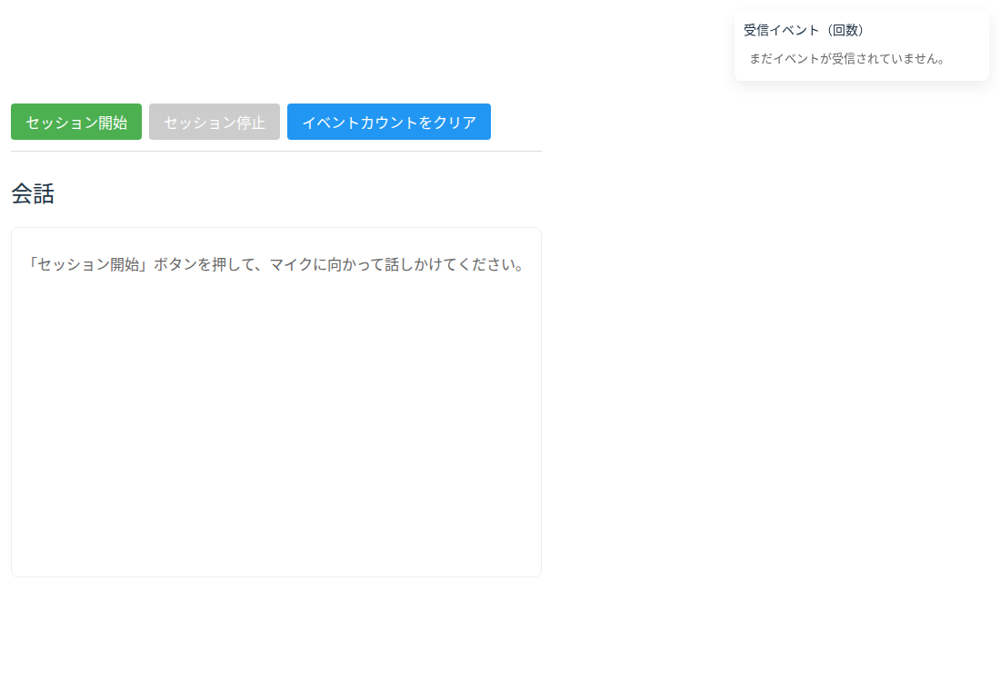

# ObjecTalk（Web版）

モノと音声で話せるアプリ「ObjecTalk」のWeb版です。
モノに人格（ロール）を持たせて、OpenAI Realtime API でリアルタイムに音声会話ができます。
Unity版（本体）のほかに、ブラウザで動く形でも制作しました。

## 画面



「セッション開始」を押してマイクに話しかけると、モノの人格と音声で会話できます。

## 機能

- WebRTC で OpenAI Realtime API に接続し、音声で会話する
- キーワードから、モノの人格（ロールプロンプト）を自動生成する
- 音声の種類やシステムプロンプトを設定で切り替えられる
- 物体検出まわりの設定コード（`src/ObjectDetection/`）を含む

## 構成

| 部分 | 役割 |
| :--- | :--- |
| フロントエンド（`src/`） | React + TypeScript + Vite。WebRTC の接続と会話UI |
| バックエンド（`src/backend/`） | Express。SDP の中継を行い、OpenAI の API キーをクライアントに渡さない |

## 使用技術

- React 19 / TypeScript / Vite
- Express（バックエンド）
- OpenAI Realtime API（WebRTC）
- OpenAI Chat Completions API（ロールプロンプトの生成）

## 動かし方

プロジェクト直下に `.env` を作り、OpenAI の API キーを設定します。

```env
OPENAI_API_KEY=...
```

バックエンドとフロントエンドを、それぞれ別のターミナルで起動します。

```bash
npm install
npm run start   # バックエンド（ポート3001）
npm run dev     # フロントエンド（Vite）
```

## 関連ドキュメント

- [AI-CONFIG-GUIDE.md](AI-CONFIG-GUIDE.md) — AI の設定
- [VOICE-SETTINGS.md](VOICE-SETTINGS.md) — 音声の設定
- [SYSTEM-PROMPT-GUIDE.md](SYSTEM-PROMPT-GUIDE.md) — システムプロンプトの設定
- [README.docker.md](README.docker.md) — Docker での実行
